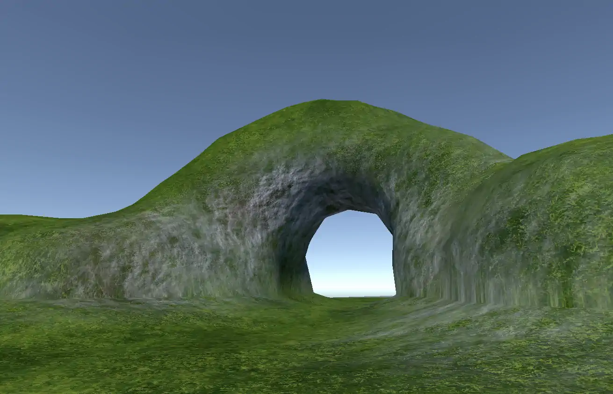

# William's Voxel Based Terrain
Terrain tool that allows overhangs, caves and other features that are missing from the Unity's default terrain system.
> [ Note ]
> AI has helped a lot with the marching cubes related code and mesh generation.

### Installation

> [ Important! ]
> This project does not have a stable version yet. This package is NOT ready for serious development.

> [ Note ]
> This package was made in and for Unity 2021.3.14f1 and I do not know the stability of this package in either later or older versions. 

> [ Note ]
> Current shaders were made for URP.

1. Open your unity project's package manager
2. Click the *plus* icon in the top left corner of the package manager
3. Click "Add a package from git URL"
4. Paste this repo's git HTTPS URL: `https://github.com/VilemMakovicka/William-s-Voxel-Based-Terrain.git`
